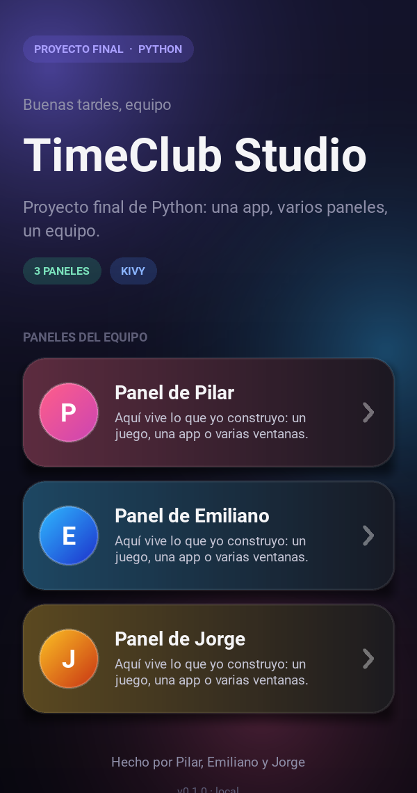
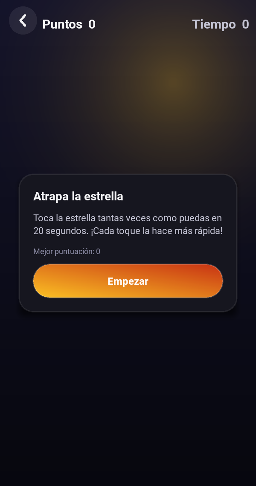
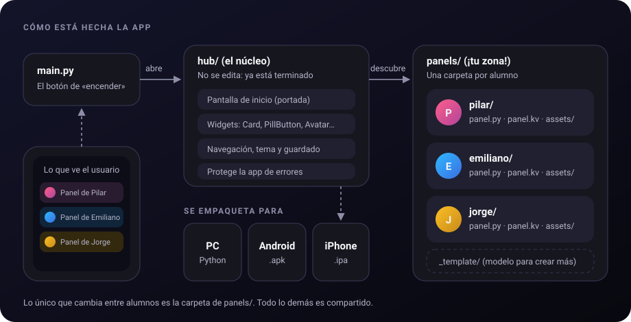
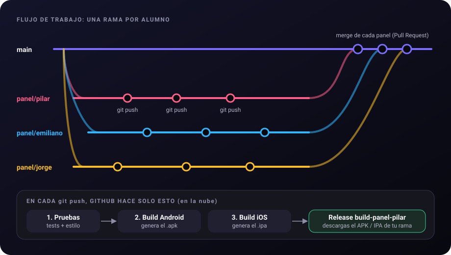

# TimeClub Studio · Proyecto final de Python con Kivy

Una app de celular hecha **entre todo el equipo**: una portada profesional y **un panel por alumno**.
Cada alumno programa lo que quiere en su panel (un juego, una app útil, varias ventanas...) y,
al final, todos los paneles se unen en una sola app que funciona en **Android, iPhone y PC**.

<p align="center">
  
  &nbsp;&nbsp;
  
  &nbsp;&nbsp;
  
</p>

**Índice:** [Cómo está hecha](#cómo-está-hecha) · [Instalar](#1-instalar-solo-la-primera-vez) · [Ejecutar](#2-ejecutar-la-app-en-el-pc) · [Tu flujo de trabajo](#3-tu-flujo-de-trabajo-día-a-día) · [Comandos](#comandos-útiles) · [Builds Android/iOS](#4-builds-automáticos-android-e-ios) · [Instalar el APK](#instalar-el-apk-android) · [Instalar el IPA](#instalar-el-ipa-iphone) · [Trabajar con IA](#5-trabajar-con-ia) · [Profesor](#6-guía-para-el-profesor) · [Problemas](#7-problemas-frecuentes)

---

## Cómo está hecha

<p align="center"></p>

| Carpeta / archivo | Qué es | ¿Lo edito? |
|---|---|---|
| `panels/<tu_nombre>/` | **Tu panel.** `panel.kv` (diseño), `panel.py` (lógica), `assets/` (imágenes, sonidos) | **Sí, aquí trabajas** |
| `hub/` | El núcleo de la app: portada, navegación, tema, widgets bonitos, protección de errores | No (ya está terminado) |
| `examples/` | Tres ejemplos completos para copiar: un juego, una app de notas y un panel con varias ventanas | Para estudiar |
| `docs/` | Guías: [`GUIA_ALUMNO.md`](docs/GUIA_ALUMNO.md), [`BUILDS.md`](docs/BUILDS.md), [`CONTEXTO_IA.md`](docs/CONTEXTO_IA.md) | Para leer |
| `main.py` | El botón de «encender» (Android e iOS exigen que se llame así) | No |
| `dev.py` | Comandos del proyecto: abrir la app, crear panel, pruebas... | No |
| `buildozer.spec` | Configuración del empaquetado para Android (y la lista de librerías) | Casi nunca |
| `.github/workflows/` | Las recetas que compilan el APK y el IPA en la nube | No |

**Idea clave:** la app **descubre sola** las carpetas de `panels/`. Para tener un panel nuevo solo se crea una
carpeta; no hay que registrarlo en ningún sitio. Y como cada alumno toca **solo su carpeta**, casi nunca hay
conflictos al unir el trabajo.

Tecnologías: **Python 3.13**, **[Kivy 2.3.1](https://kivy.org)** (con archivos `.kv` para el diseño),
[buildozer](https://buildozer.readthedocs.io) (Android), [kivy-ios](https://github.com/kivy/kivy-ios) (iPhone),
GitHub Actions (builds automáticos), pytest + ruff (calidad).

---

## 1. Instalar (solo la primera vez)

### Qué necesitas en tu computadora

| Programa | Para qué | Dónde conseguirlo |
|---|---|---|
| **Python 3.13** (sirve de 3.10 a 3.13; **no** el 3.14) | El lenguaje | <https://www.python.org/downloads/> · en Windows marca **«Add python.exe to PATH»** |
| **Git** | Guardar y subir tu trabajo | <https://git-scm.com/downloads> |
| **VS Code** (recomendado) | Editor de código | <https://code.visualstudio.com> |
| Una cuenta de **GitHub** con acceso al repositorio | Subir tu trabajo | pide al profesor que te agregue |

### Clonar el repositorio y preparar el entorno

Abre una terminal (en Windows: *PowerShell*) y ejecuta:

```bash
git clone https://github.com/DavidJara14/app-kivy.git
cd app-kivy
```

Ahora prepara todo **con un solo comando**:

| Windows | Mac / Linux |
|---|---|
| `.\setup.bat` | `./setup.sh` |

Esto busca un Python compatible, crea el entorno virtual `.venv` (una carpeta con las librerías de **este**
proyecto) e instala Kivy, pytest y ruff. La primera vez tarda 1–3 minutos. Es seguro ejecutarlo otra vez cuando
quieras: si todo está al día, no hace nada.

> **Con VS Code es aún más fácil:** abre la carpeta (`File → Open Folder`), acepta instalar las extensiones
> recomendadas y, si te pregunta, permite las *tareas automáticas*: el entorno se prepara solo al abrir el
> proyecto.

Comprueba que todo está bien:

```bash
python dev.py doctor
```

Si dice **«Todo bien»**, ya puedes empezar. Si git te pide tu identidad, ejecuta (con tus datos):

```bash
git config --global user.name "Tu Nombre"
git config --global user.email "tu@correo.com"
```

---

## 2. Ejecutar la app en el PC

```bash
python dev.py run             # la app completa, con la portada y todos los paneles
python dev.py panel pilar     # SOLO el panel «pilar» (cambia el nombre por tu carpeta)
```

Se abre una ventana con forma de celular. Atajos útiles:

| Tecla | Qué hace |
|---|---|
| **F5** | **Recarga tu panel**: guarda tu `panel.kv` o `panel.py` y mira el cambio al instante, sin cerrar la app |
| **Esc** | Volver (igual que el botón «atrás» de Android) |

Con el ratón puedes estirar la ventana para ver cómo se adapta a pantallas más anchas.

> En VS Code también puedes pulsar **F5** (menú *Run and Debug*) y elegir *«Solo mi panel»*.

Si algo de **tu** código falla mientras la app corre, no se cierra: aparece una hoja con el error, en qué
archivo y línea ocurrió, y botones para *volver* o *reintentar*. El mensaje completo sale también en la terminal.

---

## 3. Tu flujo de trabajo (día a día)

<p align="center"></p>

**Regla de oro:** nunca trabajes directamente en `main`. Cada alumno tiene **su propia rama**.

### Primer día: crea tu rama y tu panel

```bash
git switch main
git pull                              # trae lo último
git switch -c panel/pilar             # tu rama: «panel/» + tu nombre en minúsculas
python dev.py new Pilar               # crea panels/pilar/ a partir de la plantilla
python dev.py panel pilar             # ¡míralo funcionando!
```

> En este repositorio ya existen los paneles `pilar`, `emiliano` y `jorge` con la plantilla lista. Si es tu
> caso, **omite `dev.py new`** y trabaja directamente en tu carpeta.

### Cada día: trabaja, prueba y sube

1. Edita **solo tu carpeta** `panels/<tu_nombre>/`:
   `panel.kv` (cómo se ve) y `panel.py` (qué hace). Mira `examples/` y [`docs/GUIA_ALUMNO.md`](docs/GUIA_ALUMNO.md).
2. Prueba con **F5** en la ventana abierta (o `python dev.py panel <tu_nombre>`).
3. Revisa que no rompiste nada:
   ```bash
   python dev.py check
   ```
4. Guarda y sube tu trabajo:
   ```bash
   git add .
   git commit -m "Describe lo que hiciste, por ejemplo: agregué el marcador de puntos"
   git push -u origin panel/pilar       # la primera vez; después basta con: git push
   ```
5. **GitHub compila tu app automáticamente** (ver [builds](#4-builds-automáticos-android-e-ios)): en unos
   minutos tendrás un **APK** (Android) y un **IPA** (iPhone) de **tu rama** para probar en el celular.

### Traer los cambios de tus compañeros (de vez en cuando)

```bash
git fetch origin
git merge origin/main          # trae lo que ya se unió a main
```

### Al terminar: unir tu panel con el de los demás

1. En GitHub, abre un **Pull Request** de tu rama hacia `main` (aparece un botón verde después de hacer `git push`).
2. Espera la marca verde ✅ de las **Pruebas** automáticas.
3. El profesor revisa y pulsa **«Merge»**. Tu panel pasa a formar parte de la app oficial y se genera el build de `main`.

---

## Comandos útiles

Todo se hace con `python dev.py <comando>` (usa solo el entorno `.venv`, no necesitas activarlo):

| Comando | Qué hace |
|---|---|
| `python dev.py run` | Abre la app completa |
| `python dev.py panel <nombre>` | Abre **solo** el panel de esa carpeta |
| `python dev.py new <nombre>` | Crea `panels/<nombre>/` copiando la plantilla (con tu nombre y un color) |
| `python dev.py list` | Lista los paneles que la app encuentra (y si alguno tiene un error) |
| `python dev.py test` | Corre las pruebas automáticas |
| `python dev.py lint` / `fix` | Revisa el estilo del código / arregla lo que se pueda solo |
| `python dev.py check` | `lint` + `test`: **lo mismo que hace GitHub** antes de aceptar tu código |
| `python dev.py doctor` | Revisa que el entorno esté bien instalado |

---

## Estructura del repositorio

```text
app-kivy/
├── main.py                  ← punto de entrada (PC, Android e iOS)
├── dev.py                   ← comandos: run, panel, new, check...
├── setup.bat / setup.sh     ← prepara el entorno después de clonar
├── buildozer.spec           ← configuración de Android + lista de librerías de la app
├── requirements*.txt        ← librerías (PC) · pyproject.toml / pytest.ini ← herramientas
├── assets/                  ← ícono y pantalla de carga de la app
├── hub/                     ← EL NÚCLEO (no se edita)
│   ├── app.py               ·  navegación, errores, recarga con F5
│   ├── panel.py             ·  PanelScreen / PanelInfo: el «contrato» de un panel
│   ├── registry.py          ·  descubre los paneles de panels/
│   ├── home.py              ·  la portada
│   ├── widgets.py           ·  Card, PillButton, Avatar, Heading...
│   ├── theme.py · gfx.py    ·  colores, degradados y sombras
│   ├── storage.py           ·  guardado de datos de cada panel
│   └── kv/                  ·  el diseño (.kv) del núcleo
├── panels/                  ← AQUÍ TRABAJAN LOS ALUMNOS
│   ├── _template/           ·  la plantilla (no se edita)
│   ├── pilar/               ·  panel.kv · panel.py · __init__.py · assets/
│   ├── emiliano/
│   └── jorge/
├── examples/                ← juego, notas y varias ventanas (para copiar)
├── tests/                   ← pruebas automáticas (prueban TODOS los paneles solas)
├── docs/                    ← guías e imágenes
└── .github/workflows/       ← ci.yml · android.yml · ios.yml · cleanup.yml
```

---

## 4. Builds automáticos: Android e iOS

### Cómo funciona

Cada vez que haces `git push` a **cualquier rama**, GitHub arranca tres tareas en sus servidores (no usan tu
computadora):

| Workflow | Qué hace | Cuánto tarda |
|---|---|---|
| **Pruebas** (`ci.yml`) | Revisa el estilo y corre las pruebas de **todos** los paneles | 1–2 min |
| **Build Android** (`android.yml`) | Empaqueta la app con *buildozer* y genera un **`.apk`** | 25–40 min la 1.ª vez; ~10–15 con caché |
| **Build iOS** (`ios.yml`) | Compila con *kivy-ios* + Xcode y genera un **`.ipa`** sin firmar | ~40 min la 1.ª vez; ~15 con caché |

Cada rama tiene **su propio build**. Si haces otro `push` mientras se compila el anterior, el viejo se cancela
y solo se termina el último. Al acabar, los archivos se publican en **Releases**:

| Rama | Release | Archivos |
|---|---|---|
| `main` | [`build-main`](../../releases/tag/build-main) · «Versión principal» | `app-kivy-android-main.apk` · `app-kivy-ios-main.ipa` |
| `panel/pilar` | `build-panel-pilar` | `app-kivy-android-panel-pilar.apk` · `app-kivy-ios-panel-pilar.ipa` |
| `panel/jorge` | `build-panel-jorge` | … igual, con el nombre de la rama |

**Dónde descargarlos:**

- **Releases** → pestaña *Releases* del repositorio (a la derecha en la página principal, o [aquí](../../releases)).
  Cada release dice de qué commit y de qué hora es. **No hace falta iniciar sesión** para descargar.
- **Actions** → pestaña *Actions* → entra a la ejecución → sección *Artifacts* al final (requiere sesión en GitHub).
  Ahí también ves el progreso y el registro si algo falla.

Cuando borras una rama (después del merge), su release se borra sola (`cleanup.yml`).

> **¿Cómo sé qué versión tengo instalada?** La portada de la app muestra al final `v0.1.0 · <rama> · <commit>`.
> Compárala con el commit de la release para saber si estás probando tu última versión.

La explicación detallada (cada paso de los workflows, cachés, errores comunes, builds firmados) está en
[`docs/BUILDS.md`](docs/BUILDS.md).

### Instalar el APK (Android)

1. En el celular, abre la página de **Releases** del repositorio y descarga el `.apk` de **tu rama**
   (o descárgalo en el PC y pásalo por cable USB, Drive o WhatsApp).
2. Ábrelo. Android te pedirá permiso para **«instalar apps desconocidas»** del navegador o del gestor de
   archivos que uses: actívalo solo para esa app.
3. Si aparece el aviso de **Play Protect** («app no verificada»), pulsa **«Instalar de todos modos»**.
   Es normal: es una app de desarrollo y no viene de la Play Store.
4. Abre **TimeClub Studio**. La próxima vez que quieras probar una versión nueva, instala el APK nuevo
   *encima* (se actualiza sin perder tus datos).

Alternativa con cable USB (para quien tenga Android Studio / `adb`): `adb install -r app-kivy-android-<rama>.apk`.

### Instalar el IPA (iPhone)

El `.ipa` **no está firmado** por Apple, así que hay que firmarlo con tu Apple ID al instalarlo. Se puede hacer
**desde Windows o Mac, gratis**, con [Sideloadly](https://sideloadly.io):

1. Descarga el `.ipa` de tu rama desde **Releases**.
2. **Windows:** instala **iTunes** y **iCloud** descargados desde *apple.com* (no los de la Microsoft Store) y
   después Sideloadly. **Mac:** solo Sideloadly.
3. Conecta el iPhone por USB y acepta **«Confiar en este equipo»**.
4. Abre Sideloadly, arrastra el `.ipa`, escribe tu **Apple ID** y pulsa **Start**.
5. En el iPhone: *Ajustes → General → VPN y gestión de dispositivos* → tu Apple ID → **Confiar**.
6. **iOS 16 o superior:** *Ajustes → Privacidad y seguridad → Modo de desarrollador* → actívalo y reinicia.
7. Abre **TimeClub Studio** desde la pantalla de inicio.

**Limitaciones del Apple ID gratuito:** la app **caduca a los 7 días** (hay que volver a instalarla con
Sideloadly) y solo puedes tener unas 3 apps instaladas así a la vez. Con una cuenta de pago de Apple Developer
(99 USD/año) no caduca tan pronto y se podría firmar directamente en el build (ver `docs/BUILDS.md`).

**Simulador de iPhone (solo si tienes un Mac con Xcode):** descarga `app-kivy-ios-<rama>-simulador.zip`,
descomprímelo, abre el *Simulador* (Xcode → Open Developer Tool → Simulator) y arrastra el `.app` sobre la
ventana del simulador, o ejecuta `xcrun simctl install booted <ruta_al_.app>`.

> ⚠️ Los builds de iOS se compilan en GitHub, pero **solo un iPhone real confirma que todo se ve y funciona
> igual**. Si notas algo distinto entre PC, Android e iPhone, abre un *Issue* en GitHub y cuéntalo.

---

## 5. Trabajar con IA

Puedes pedirle ayuda a una IA (ChatGPT, Gemini, Copilot, un agente en VS Code...) para escribir el código de
tu panel. Para que **entienda cómo está hecho este proyecto**, dale primero el archivo
[`docs/CONTEXTO_IA.md`](docs/CONTEXTO_IA.md):

- **IA en el navegador:** abre el archivo, **copia todo su contenido** y pégalo como **primer mensaje**.
  Después cuéntale qué quieres hacer.
- **Agente dentro del proyecto** (Copilot, Cursor, Codex...): ya lee `AGENTS.md` o `.github/copilot-instructions.md`,
  que apuntan a ese archivo. Si no, dile: *«Lee docs/CONTEXTO_IA.md y trabaja solo dentro de mi carpeta panels/<nombre>/»*.

Ese archivo le explica a la IA cómo está organizado el repo, qué librerías y widgets existen, **qué carpeta puede
modificar** y **cómo deben escribirse los archivos** para que funcionen también en el celular. Aun así: ¡lee y
entiende lo que te da la IA antes de usarlo, y pruébalo!

---

## 6. Guía para el profesor

**Antes de empezar (una sola vez, en GitHub → *Settings* del repositorio):**

1. **Colaboradores** (*Collaborators*): agrega a cada alumno con permiso **Write** (para que puedan hacer `git push` a sus ramas).
2. **Actions → General → Workflow permissions:** deja *«Read and write permissions»* (los builds publican en Releases).
   Los workflows ya piden `contents: write`, pero una política de la organización podría bloquearlo.
3. **Protege `main`** (*Settings → Branches → Add rule* para `main`): exige *Pull Request* y que pasen las
   pruebas (`tests`). Así nadie rompe `main` por accidente y solo tú haces el merge.
4. Mantén el repositorio **público**: los minutos de GitHub Actions son gratis y, sobre todo, los builds de
   macOS (iOS) **no consumen cuota**. En un repo privado, cada minuto de macOS cuenta ×10: en ese caso edita
   `ios.yml` y deja `branches: [main]`.

**Mover el repositorio a la organización `ct-timeclub`:** *Settings → Danger Zone → Transfer ownership*. Un
dueño de la organización debe aceptar la transferencia. Después, los alumnos actualizan su remoto con
`git remote set-url origin https://github.com/ct-timeclub/app-kivy.git`. Los enlaces relativos de este README
(Releases) siguen funcionando.

**Para unir el trabajo al final:** revisa cada Pull Request (hay una lista de verificación), espera la marca verde y usa
*Merge pull request*. Como cada alumno solo toca su carpeta de `panels/`, no hay conflictos; solo si alguien
cambió `hub/` o `requirements.txt` habrá que mirar con cuidado. Al borrar la rama, su release se limpia sola.

**Cambiar el nombre, el color o el texto de la app:** `hub/config.py` (nombre, descripción, versión) y
`hub/theme.py` (colores). La versión también va en `buildozer.spec` (`version = ...`): hay una prueba que avisa si no coinciden.
Para regenerar el ícono: `python scripts/make_assets.py`.

---

## 7. Problemas frecuentes

| Problema | Solución |
|---|---|
| `setup` dice que no encuentra Python 3.10–3.13 | Instala Python 3.13 desde python.org (en Windows marca *Add to PATH*), cierra y abre la terminal. Kivy **no** funciona con Python 3.14. |
| `python` no se reconoce (Windows) | Usa `py dev.py ...` o reinstala Python marcando *Add python.exe to PATH*. |
| `python dev.py` dice «Todavía no hay entorno virtual» | Ejecuta `setup.bat` / `./setup.sh` primero. |
| La ventana no abre o sale un error de OpenGL | Actualiza los controladores de video. En Linux: `sudo apt install libgl1 libmtdev1`. |
| Mi panel aparece en rojo en la portada | Tiene un error. El mensaje dice cuál. Revisa `__init__.py` (¿existe `PANEL`?) y que el `id` sea igual al nombre de la carpeta. |
| Mi cambio en `panel.kv` no se ve | Pulsa **F5** en la ventana de la app. Revisa que la regla `<MiPanel>:` tenga el mismo nombre que la clase en `panel.py`. |
| `git push` me pide usuario y contraseña | GitHub ya no acepta contraseña: usa el inicio de sesión del navegador (Git Credential Manager) o un *Personal Access Token*. |
| Falló el build de Android por un error de red | Pasa a veces (descargas del SDK): el workflow reintenta 3 veces. Si falla, pulsa *Re-run jobs* en Actions. |
| Agregué una librería y el build falla | Agrégala en `requirements.txt` **y** en `requirements = ...` de `buildozer.spec`. Ojo: solo funcionan librerías de Python puro o con receta para móviles. Ver [`docs/GUIA_ALUMNO.md`](docs/GUIA_ALUMNO.md#agregar-una-librería-nueva). |
| El APK no se instala | Permite «instalar apps desconocidas» para la app desde la que lo abres; si ya había una versión firmada distinta, desinstálala primero. |
| La app de iPhone dejó de abrir a la semana | El Apple ID gratuito caduca a los 7 días: reinstala con Sideloadly. |

¿Algo más? Abre un **Issue** en GitHub o pregunta al profesor.
